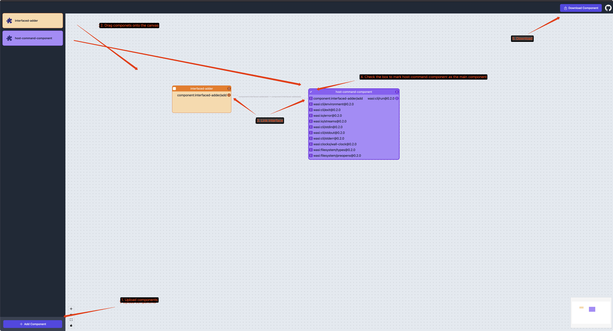

# Rust command component

This example imports the adder interface, calls it from `main()`, and prints the result.
It uses `wit_bindgen::generate!` to generate bindings during compilation and builds directly with Cargo for `wasm32-wasip2`.
The macro loads the adder's WIT package before this component's `host` world, replacing the dependency resolution previously handled by `cargo-component` metadata.
There is no separate `wit-bindgen-rt` dependency or `cargo-component` build step.

Rust's `wasm32-wasip2` binary build supplies the `wasi:cli/run` entrypoint for `main()`.
The [component tutorial](https://component-model.bytecodealliance.org/tutorial.html#create-a-command-component) describes another approach: a `cdylib` that explicitly exports and implements `wasi:cli/run`.
The [Rust runnable-components guide](https://component-model.bytecodealliance.org/language-support/creating-runnable-components/rust.html) documents both approaches.
Both can be executed with `wasmtime run` after their application imports are satisfied through composition.

## Build and run

Run these commands from `host-command-component/` with the `wac` and `wasmtime` CLIs installed.

1. Install the Rust target and build the command component:

   ```sh
   rustup target add wasm32-wasip2
   cargo build --target wasm32-wasip2
   ```

2. Build the adder component:

   ```sh
   cargo build -p guest-interfaced-adder-rs --release --target wasm32-wasip2
   ```

3. Compose the command and adder components:

   ```sh
   wac plug ../target/wasm32-wasip2/debug/host-command-component.wasm \
     --plug ../target/wasm32-wasip2/release/guest_interfaced_adder_rs.wasm \
     -o ../target/composed-component.wasm
   ```

   Alternatively, upload the two input components to [wasmbuilder.app](https://wasmbuilder.app/) and compose them as shown below.

   

4. Run the composed component:

   ```sh
   wasmtime run ../target/composed-component.wasm
   ```

   Expected output: `result: 3`.
